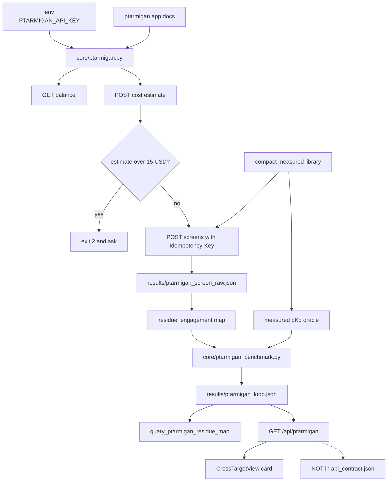

# Option 1 — Close the Loop on a Ptarmigan-1 Screen

Additive cross-modality extension: a live structure-free co-embedding screen, closed by the
`3:1:1` falsification loop. **Zero edits to locked artifacts, zero edits to the pinned arsenal.**

---

## 0. Verified premises (measured from this repo, not assumed)

| premise | evidence |
|---|---|
| The council arsenal is pinned at **exactly 6 tools** | [`tests/test_core.py:45`](../tests/test_core.py:45) `len(TOOL_REGISTRY)==6`; [`tests/test_stage_readiness.py:541`](../tests/test_stage_readiness.py:541) asserts the exact ordered name list and `len(names) == 6`; [`:558`](../tests/test_stage_readiness.py:558) asserts the tier partition is *equal* to `TIER_SOP` / `TIER_DRILLS` |
| `tool_outputs` keys are pinned to that same 6-set | [`tests/test_stage_readiness.py:175`](../tests/test_stage_readiness.py:175) `assert set(outputs) == {...}` |
| The locked contract is **`./api_contract.json`**, not `results/api_contract.json` | that path does not exist; `SETTINGS` has no such entry; the generator writes `ROOT / "api_contract.json"` |
| The contract bundle is exactly 4 endpoints | [`scripts/generate_api_contract.py:38`](../scripts/generate_api_contract.py:38) `ENDPOINTS` |
| Contract staleness fails the suite | [`tests/test_api_sync.py:313`](../tests/test_api_sync.py:313) `--check`; [`tests/test_core.py:57`](../tests/test_core.py:57) `state.keys() == contract.keys()` |
| Only contract numbers are banned as literals | [`frontend/scripts/audit-literals.ts:99`](../frontend/scripts/audit-literals.ts:99) iterates `["state","benchmark","cross_target","attribution"]` |
| `zero-shot` is banned **visible copy** | [`frontend/scripts/audit-copy.ts:54`](../frontend/scripts/audit-copy.ts:54) `/\bzero-shot\b/i` |
| Views may not hand-format a metric | [`frontend/scripts/audit-copy.ts:67`](../frontend/scripts/audit-copy.ts:67) `HAND_FORMATTED` |
| No test enumerates routes, so a 5th endpoint is safe | `search_files` over `tests/` for `routes|iter_routes|app.router` → 0 results |
| `render-smoke` 404s unknown routes | [`frontend/scripts/render-smoke.tsx:166`](../frontend/scripts/render-smoke.tsx:166) → `useResource` → `status:"error"` |
| `CrossTargetView` is constructed with 3 props in the harness | [`frontend/scripts/render-smoke.tsx:445`](../frontend/scripts/render-smoke.tsx:445) |
| Tests never load `.env` | [`tests/conftest.py:13`](../tests/conftest.py:13) points `LLM_ENV_FILE` at a missing path |
| `PTARMIGAN_API_KEY` is already present in `.env` | `.env:5` — never printed, never committed (`.gitignore:2`) |
| AUBQC's shape is reusable verbatim | `R=6, k=5 → Q=35`, checkpoints `5..35`, normaliser `1/30` — identical to 1N8Z ([`core/constants.py:33`](../core/constants.py:33)) |
| `BootstrappedExtraTrees` is feature-agnostic | [`core/surrogate.py:17`](../core/surrogate.py:17) takes any `X` — reusable for small molecules |
| `freeze_protocol` **rejects** labelled frames | [`core/preregistration.py:21`](../core/preregistration.py:21) — so the compound pool needs its own label-blind freeze |

### Corrections to the brief

1. **`results/api_contract.json` does not exist.** The locked contract is [`api_contract.json`](../api_contract.json). It stays byte-identical: the new endpoint is deliberately kept **out** of `ENDPOINTS`.
2. **`npm run check` is 7 stages, not 6** — `typecheck · contract · verify · audit:literals · audit:copy · audit:i18n · audit:render` ([`frontend/package.json:17`](../frontend/package.json:17)). All 7 stay green.
3. **`query_ptarmigan_residue_map` must not enter `TOOL_REGISTRY`.** Registering a 7th tool breaks ≥3 tests. It ships as a module-level read-only function in [`core/tool_arsenal.py`](../core/tool_arsenal.py), outside the registry/tiers/routing/order tables.

### Blocking unknown (cannot be resolved in Architect mode)

The Ptarmigan-1 endpoint surface is **unverified**. `ptarmigan.app/llms.txt` and
`/docs/python` were not reachable with the tools available here (no shell in this mode; web
search returned marketing pages, not the API reference). Every path in the brief
(`/api/v1/screens`, `/hits`, `?include_residues=true`, `detail["residue_engagement"]`, the
balance and cost-estimate routes) is therefore a **hypothesis**, not a fact.

**Step 1 of execution is a hard gate**: fetch both docs with `curl` in Code mode, reconcile the
real surface, and only then write request code. `core/ptarmigan.py` is designed so the route
table is a single declarative constant that the reconciliation edits — no call site changes.

### Decisions locked

| decision | resolution |
|---|---|
| Wet-lab oracle for Stage B | **ChEMBL, target `CHEMBL1824` (human ERBB2)**. Real measured affinities, not simulated — the head-to-head is quotable as a real-world result. |
| Library size | **250–300 compounds**, spanning `pchembl_value` ≈ 5.0–9.5 so there is a genuine affinity gradient for the 6-round campaign and the screen stays cheap. |
| Ptarmigan docs | Fetched in Code mode as Step 1, **before** any request code is written. |
| Test-count pill | `pinned.ts` is bumped to the new total (§6). It is the sanctioned home for repository facts, is `audit-literals`-allowlisted, and no test asserts its string. |

---

## 1. Architecture

Two-stage split, one artifact per concern:

| stage | produces | re-runnable offline |
|---|---|---|
| **A** live screen | `results/ptarmigan_screen_raw.json` (verbatim responses) + engagement vector | yes — `--offline` reads the raw file, spends 0 credits |
| **B** 50-seed benchmark | `results/ptarmigan_loop.json` | yes — depends only on stage A's cached output |

---

## 2. Stage A — the screen, credit-safe

**Library: ChEMBL `CHEMBL1824` (human ERBB2).** The same curated table is both the library we
upload to Ptarmigan-1 **and** the wet-lab oracle for Stage B. That identity is the whole point:
a join against Talus's default library would leave most rows unmeasured, which would make
`ptarmigan_zeroshot` an unfairly weak baseline. ERBB2 also matches the Trastuzumab `1N8Z`
antigen story, so the two halves of the demo share one target.

Curation rules, applied in `core/ptarmigan_library.py` against the ChEMBL API:

- `target_chembl_id = "CHEMBL1824"`, `assay_type = "B"` (binding), `standard_relation = "="`
  (exact, not `<` / `>` censored values), `pchembl_value` non-null.
- Canonical-SMILES standardisation, then **deduplicate by canonical SMILES taking the median
  `pchembl_value` per compound**. Median, not mean: ERBB2 has replicate-heavy series and a mean
  lets one outlier serum read as a discovery.
- Desalt / strip salts where the SMILES allows, drop inorganics and elements, drop polymers and
  sequences (`molecule_type = "SMALL MOLECULE"` only).
- **Cap at 250–300 compounds spanning a wide dynamic range** (`pchembl_value` ≈ 5.0–9.5). Stratify
  by affinity decile rather than taking the top N, so the pool is not a wall of near-identical
  high-affinity inhibitors — a flat pool would make every method's ρ degenerate.
- The oracle column is `pchembl_value` (already $-\log_{10}$ of the molar concentration, i.e. the
  same units as the antibody benchmark's `y_bind`), so AUBQC and ρ are directly comparable to the
  1N8Z numbers.
- ChEMBL is EBI-hosted and needs no key, but it does rate-limit anonymous traffic: send the same
  custom `User-Agent`, paginate, and cache the raw JSON to
  `data/raw/chembl_erbb2_raw.json.gz` so a re-run costs no extra requests.

Everything about the freeze is **label-blind**: the protocol hashes `(compound_id, SMILES)` only.
No `pchembl_value` enters the preregistration, mirroring `freeze_protocol`'s refusal to read
labels.

**Rules encoded in `core/ptarmigan.py`.**

- Key from `os.environ["PTARMIGAN_API_KEY"]`, read **inside the request function**, never at
  import time (so importing the module in tests builds no client and opens no socket).
- Every request carries `User-Agent: virtual-lab-dnaforge/1.0`. Cloudflare rejects the default
  `httpx` agent before the origin, so this is not cosmetic — it is the difference between a
  screen and a 403.
- **Order: balance → estimate → confirm → create.** `--dry-run` stops after the estimate.
- **One `Idempotency-Key` per logical screen**, derived as
  `sha256(target || library_sha256 || protocol_version)[:32]`. A retry replays the same key, so
  a network timeout can never double-charge.
- Estimate > \$15 → exit `2` with the number printed, no `POST`. (`SETTINGS.assay_cost_usd=1500`
  is the *wet-lab* cost and is unrelated to this gate.)
- Rate-limit awareness: the portal allows ~10 screens/day; the script creates **at most one**.
- Raw responses are persisted verbatim before any parsing, so a parsing bug never costs a
  second screen.
- Transport is injectable (`PtarmiganClient(transport=...)`) → unit tests use a fake, no network.

**Residue map.** For the top predicted compounds, fetch per-compound detail with residues
included and keep `residue_engagement` as a sparse vector over target residue indices,
normalised, tagged `catalytic` vs `allosteric` by index range against the known kinase/HER2
domain boundaries. This vector is the only thing Stage B's prior consumes — no coordinates, no
pose, keeping the "structure-free" claim honest.

---

## 3. Stage B — the falsification benchmark, 50 seeds

**Protocol.** `R=6` rounds × `k=5` wells, `Q=35`, checkpoints `5..35`, AUBQC normaliser `1/30`
— structurally identical to the frozen 1N8Z protocol, so the two experiments are legible
side by side. The `3:1:1` law maps onto the existing slot design: slots 1/2/4 exploit, slot 3
explore, slot 5 is the $H_0$ control.

**Features.** A dependency-free molecular featuriser: hashed SMILES character n-gram
fingerprint plus a small physicochemical count vector. Deliberately **not** `core/features.py`
(299-dim residue encoding, antibody-only) and **not** RDKit (not in `requirements.txt`).

**Qualification.** Label-blind drug-likeness rule → `N_qual`. Frozen to
[`config/ptarmigan_protocol.json`](../config/) — a **new** file; the 1N8Z preregistration is
untouched. Because `freeze_protocol` rejects labelled frames, this module writes its own
freeze: `sha256` of the sorted `(compound_id, SMILES)` list, the qualification rule, and the
budget — **no affinity value appears in it**.

**Four rows, three of them the brief's three.**

| key | what it is | wells |
|---|---|---|
| `ptarmigan_zeroshot` | Static engagement ranking, never entering the lab. Ranking-only: $\rho$ and top-5 quality are defined; **AUBQC is `null`**, because a method that spends nothing has no area under a discovery curve. | 0 |
| `ptarmigan_static` | **Added for fairness.** The same 35 wells as the loop, but spent in static engagement order — no learning. This is the honest budget-matched form of "static virtual screening". | 35 |
| `m3_ucb_cold` | ExtraTrees UCB on molecular features, random cold start, no Ptarmigan prior. | 35 |
| `m5_ptarmigan_hybrid` | Warm start = top-5 by engagement. $\Delta_{\text{agent}}$ = bounded hotspot-profile cosine similarity to the **already-validated** compounds. Slot 5 = `a_null := a_base`, i.e. what `m3_ucb_cold` would pick next. | 35 |

**The falsification mechanism** (the prize-winning part). Each round, slot 5 measures the
displaced baseline candidate. If the control beats the promoted arm's mean by more than
`DECISIVE_LIFT`, the Ptarmigan prior is **inverted** for the residues that drove it, exactly as
`audit_past_hypotheses` gates on measured residuals rather than on level shifts. So a virtual
hit that the wet lab refutes mid-campaign stops steering later picks — the loop is allowed to
prove its own prior wrong.

**Statistics.** Paired across matched seeds, Student-t two-sided, `seeds_won` as
`wins_out_of_50`. The helper is implemented locally **and tested for numerical agreement with
[`core/baselines.py::_paired_test`](../core/baselines.py:786)**, so a Ptarmigan p-value is computed
by the same arithmetic as the published 1N8Z p-value. Reported per comparison:
`spearman_rho`, `aubqc`, `mean_diff`, `se`, `t_stat`, `p_value`, `wins_out_of_50`, plus
`false_positive_rate` (share of the prior's top-10 that the loop measured below the pool median)
and `top_hotspot_residues`.

**Degenerate cases** (`N<2`, `se==0`, undefined $\rho$) emit `null`/`NaN` exactly as
`_paired_test` does, so the frontend's em-dash path is exercised rather than crashed.

---

## 4. Backend seams (all additive)

| file | change | why it is safe |
|---|---|---|
| `core/ptarmigan.py` | **new** client + route table | nothing imports it yet |
| `core/ptarmigan_library.py` | **new** ChEMBL `CHEMBL1824` curation → `(compound_id, SMILES, pchembl)`; writes `data/processed/ptarmigan_erbb2.csv` and caches raw JSON | new file; `data/raw/` and `data/processed/` hold no locked data |
| `core/ptarmigan_benchmark.py` | **new** methods, featuriser, stats | no shared mutable state |
| `scripts/run_ptarmigan_loop.py` | **new** CLI; writes only `results/ptarmigan_loop.json`, `results/ptarmigan_screen_raw.json`, `config/ptarmigan_protocol.json` | never opens any locked path; no `--merge` into `cross_target_benchmark.json` |
| `core/tool_arsenal.py` | add `query_ptarmigan_residue_map()` **outside** `TOOL_REGISTRY` | the 6-tool pins stay true |
| `app/server.py` | add `ptarmigan_payload()` + `GET /api/ptarmigan`, mtime-cached, `available:false` when the artifact is absent | mirrors `_lockbox_metadata`; `ENDPOINTS` untouched → contract byte-identical |
| `.env.example` | document `PTARMIGAN_API_KEY` + the `User-Agent` rule | docs only |
| `tests/test_ptarmigan.py` | **new** fake-transport tests, featuriser determinism, stats agreement, artifact schema, endpoint availability | no network, no `.env` |

`results/benchmark_100seeds.json`, `results/cross_target_benchmark.json`,
`api_contract.json`, `results/golden_seed21.sqlite3`, `results/campaign.sqlite3`,
`config/frozen_protocol.json` are **never opened for writing** by any new code path.

---

## 5. Frontend seam (guard-rail compliant)

| file | change |
|---|---|
| `src/types/report.ts` | add `PtarmiganPayload` (an allowed file for tokens) |
| `src/lib/api.ts` | add `endpoints.ptarmigan` |
| `src/lib/plain.ts` | add `PLAIN` entries for the new stats + derivations; **no result literals** |
| `src/lib/derive.ts` | add `ptarmiganRows`, `hotspotBars`, `zeroshotVsLoop` |
| `src/views/cross/CrossTargetView.tsx` | new **optional** `ptarmigan` prop → card *"Cross-Modality Extension · Structure-Free Small Molecules (Ptarmigan-1)"* |
| `src/App.tsx` | fetch the resource, pass it down |
| `scripts/render-smoke.tsx` | serve `/api/ptarmigan` in `ROUTES`; assert **both** branches |
| `scripts/verify-numbers.ts` | `verifyPtarmigan()` reading `results/ptarmigan_loop.json` directly, skipped when absent |

Guard rails, concretely:

- **Prop is optional.** The harness constructs `CrossTargetView` with three props; a required
  fourth would fail `npm run typecheck` (scripts are in `tsconfig.include`). Optional + a
  `ROUTES` fixture covers the hot branch without touching that call site's contract.
- **No hardcoded numbers.** Ptarmigan values are absent from `api_contract.json`, so
  `audit-literals` cannot catch a paste — the discipline is manual, and `verify-numbers` is what
  enforces it: every rendered figure is recomputed from the artifact and asserted equal.
- **Copy audit.** No visible `zero-shot`, `AUBQC`, `VoI`, `Spearman ρ`, `$-\log_{10}K$`,
  `H0 vs H1`, or `lockbox`. Plain labels via `PLAIN[...]`/`methodName(...)`; all formatting through
  `lib/format.ts`; no `.toFixed(` on a metric field in a view.
- **No `undefined`/`NaN`/`null` in markup.** `expectNoMissingValues` runs on every render, so
  every nullable field has an em-dash or `EmptyState` path.
- **Method keys** `ptarmigan_zeroshot` / `ptarmigan_static` / `m3_ucb_cold` /
  `m5_ptarmigan_hybrid` get `METHOD_WORDS` + `METHOD_META` entries so the surface names them in
  words, not tokens.

---

## 6. Resolved — the test-count pill

Adding `tests/test_ptarmigan.py` raises the suite above 109, which makes
[`src/lib/pinned.ts:18`](../frontend/src/lib/pinned.ts:18) `backendTests: "109 / 109"` — rendered by
[`Header.tsx:267`](../frontend/src/components/Header.tsx:267) — false. Nothing asserts the string, so
either choice is green; only one is honest.

**Decision: bump it.** `pinned.ts` is the sanctioned home for repository facts no endpoint serves
and is `audit-literals`-allowlisted, so this is the one intended edit to a pinned file, and it is
one line. Concretely:

- `backendTests` becomes the real post-change total, measured by running `pytest -q` — never
  guessed.
- `lockedCommit` stays `28b2520`, because that is the commit the *golden ledger* was frozen at;
  the pill's other three fields describe the locked artifacts, not this PR.
- Add `ptarmiganOracle: "ChEMBL CHEMBL1824 (ERBB2), assay_type B, median pchembl_value per
  canonical SMILES"` so the pill states where the wet-lab truth came from. The screen's
  `screen_id` and library `sha256` are **not** pinned here — they are served by
  `GET /api/ptarmigan` and must be read from the payload, not typed into the source.

The `109 / 109` figure stays quotable for the locked antibody artifacts: the plan's Step 10 prints
the baseline count and the new count separately, so "109 green before, N green after, four locked
artifacts byte-identical" is one verifiable sentence rather than a moved goalpost.

---

## 7. Verification

1. `pytest -q` — all pass, including `test_api_contract_is_generated_from_the_backend` (proves the
   contract was not drifted) and the 6-tool pins (proves the arsenal was not widened).
2. `shasum -a 256` on the four locked artifacts, before and after → identical.
3. `node --version` → 22.x (`render-smoke` needs `node:sqlite`).
4. `cd frontend && npm run check` → 7/7 stages green.
5. `npm run build` → zero errors.
6. Print: `screen_id`, target, library size, top engaged residue indices; then the head-to-head
   table with `ptarmigan_zeroshot` / `ptarmigan_static` / `m3_ucb_cold` / `m5_ptarmigan_hybrid`
   and the paired `mean_diff ± se`, `p_value`, `wins_out_of_50`.
